<div align="center">

# Prompt Critical

**An industrial complex for Minecraft, from the coal mine to the closed nuclear fuel cycle.**

Coal and steam, steel and power, oil and gas, chemistry and nuclear power,
run by plant I&C that you design and build yourself.

[](https://github.com/denfry/Prompt_Critical/actions/workflows/build.yml)


[](https://github.com/denfry/Prompt_Critical/releases/latest)
[](LICENSE)

[Download](https://github.com/denfry/Prompt_Critical/releases/latest) ·
[Site](https://denfry.github.io/Prompt_Critical/) ·
[Wiki](https://github.com/denfry/Prompt_Critical/wiki) ·
[Roadmap](https://github.com/denfry/Prompt_Critical/wiki/Roadmap) ·
[Building](https://github.com/denfry/Prompt_Critical/wiki/Building-from-Source)

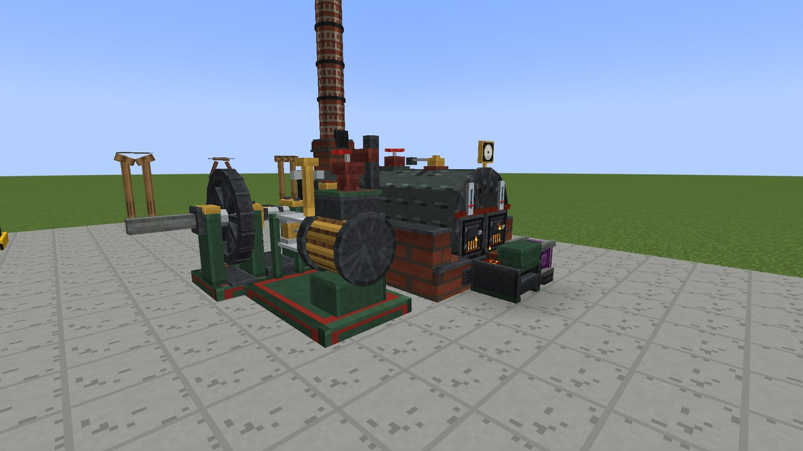

</div>

> [!NOTE]
> **1.0.0-rc.1 is out.** Every industry era of the design, I0 to I4, and every reactor tier from the graphite pile
> to the fast reactor are in the game, with the plant I&C, operations and accident layers. Get the jar from the
> [releases page](https://github.com/denfry/Prompt_Critical/releases/latest). Balance values are not final yet, and
> worlds from earlier builds need a backup before updating: see the breaking changes in the [changelog](CHANGELOG.md).

### What is in the game

- **Coal and steam (I0)**: coal mine with methane, ventilation, degasification, explosions and flooding; mine hoist;
  fire-tube boiler and steam engine on a Create shaft; foundry and machine shop.
- **Steel and power (I1)**: coke ovens, blast furnace with hot blast stoves, converter and electric arc furnace,
  seamless pipes; synchronous generators, overhead lines, distribution transformers, protection relays,
  under-frequency load shedding, a daily load curve, a dispatch center and emergency diesel generators.
- **Non-ferrous metals**: Bayer alumina and Hall–Héroult aluminium, copper smelting and converting, electrorefining of
  copper and nickel, cobalt, tin and the platinum group metals.
- **Oil and gas (I2)**: seismic survey, drilling with kicks, well kill, stuck pipe and BOP stacks; logging and coring,
  pumpjacks with dynamometer cards, gas lift and water injection; crude unit, desalter, vacuum column, cracking,
  reforming, hydrotreating, coking, Claus and amine units; gasoline blending with a laboratory; gas processing and
  helium; pipelines with pigs and cathodic protection; jet fires, vapour cloud explosions, BLEVE and oil spills.
- **Chemistry (I3)**: pyrolysis and polymers, chlor-alkali and PVC, nitrogen and methanol, combined cycle.
- **Nuclear (I4)**: uranium ore to yellowcake, UF₆ and enrichment, fuel fabrication, the graphite pile, AM-1 type
  channel reactor, PWR, BWR, CANDU and sodium fast reactor with their accident layers up to core melt and hydrogen,
  reprocessing with MOX and minor actinides, waste, isotopes, RTGs and a TRIGA pulse reactor.
- **Plant I&C**: relay logic, analog computers, PLCs in IL, ST, LD, FBD and SFC with a ladder editor, safety
  instrumented systems with proof tests, ISA-18.2 alarms and annunciators, control rooms, a historian, a digital twin
  and training simulator, and a CC: Tweaked device layer with the `pcui` screen library.
- **Operations**: lockout/tagout, work permits with gas testing, confined spaces, equipment rounds, personal
  protective equipment, turnarounds, crew dose, flares and fire fighting with foam.
- **World**: generated survey camps, old mines, asphalt lakes, gas craters, natural reactors; an engineering handbook,
  a route of tasks and the full achievement catalogue.

### Screenshots

| | |
|---|---|
| 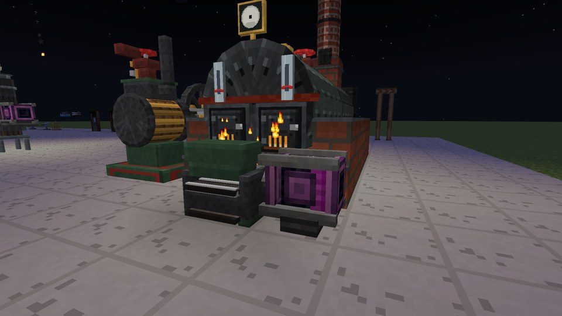 | 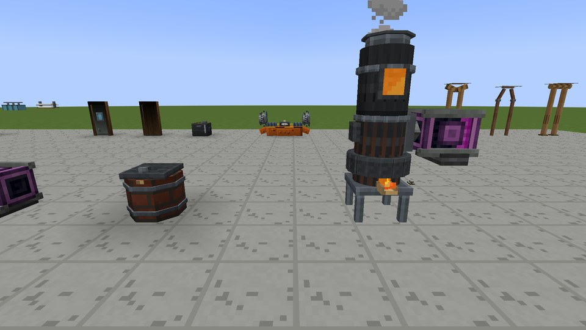 |
| I0: fire doors glowing at night | I0: cupola and crucible furnace |
| 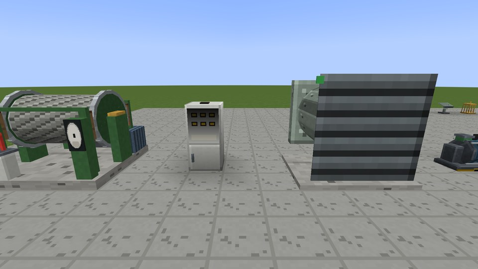 | 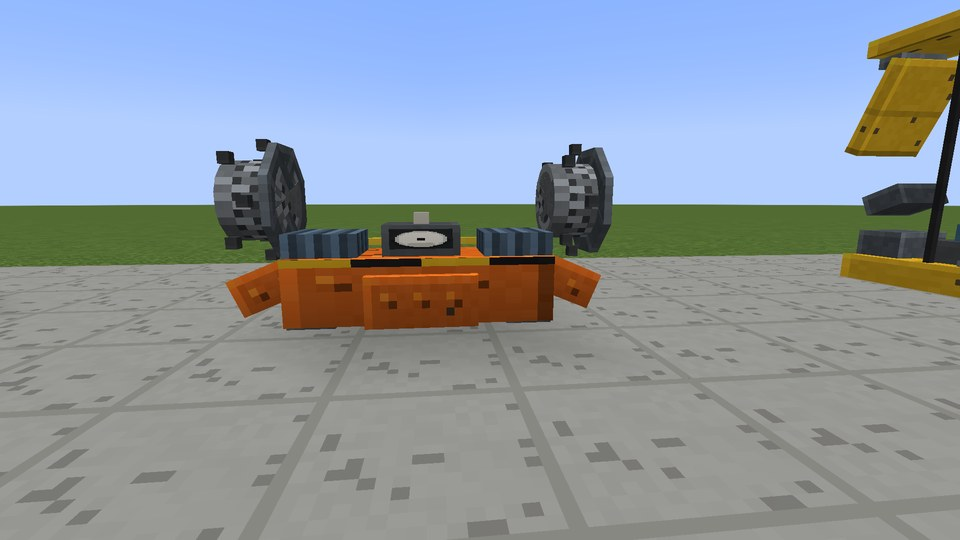 |
| I0: mine hoist, gas monitoring cabinet and main fan | I0: longwall shearer |

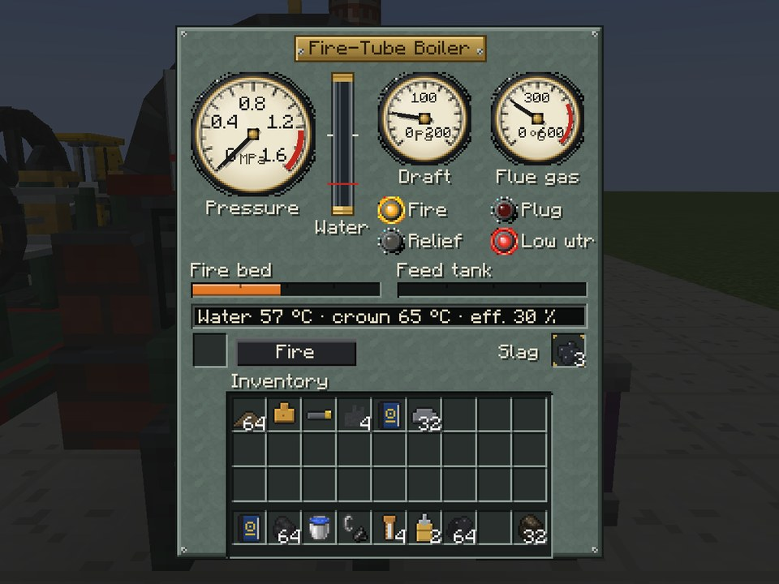

Each machine has its own local panel; the boiler's shows pressure, the gauge glass, draft and flue gas.

The later eras, as their in-game test rigs build them:

| | |
|---|---|
| 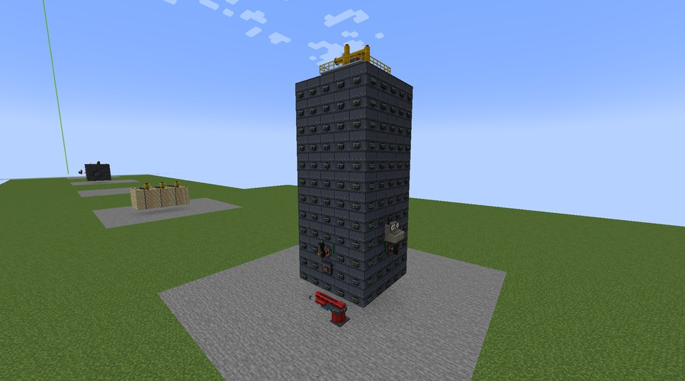 | 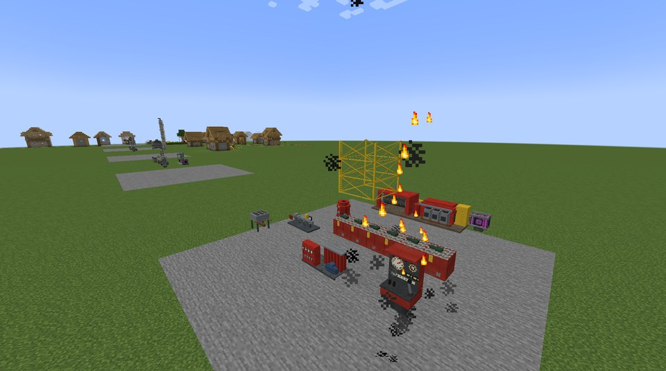 |
| I1: blast furnace | I2: a gas kick on the drilling rig |
| 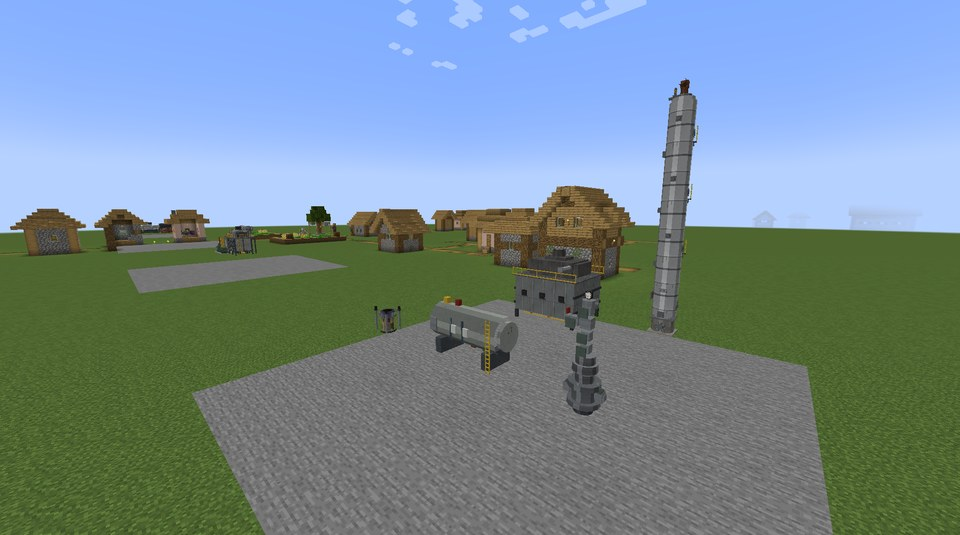 | 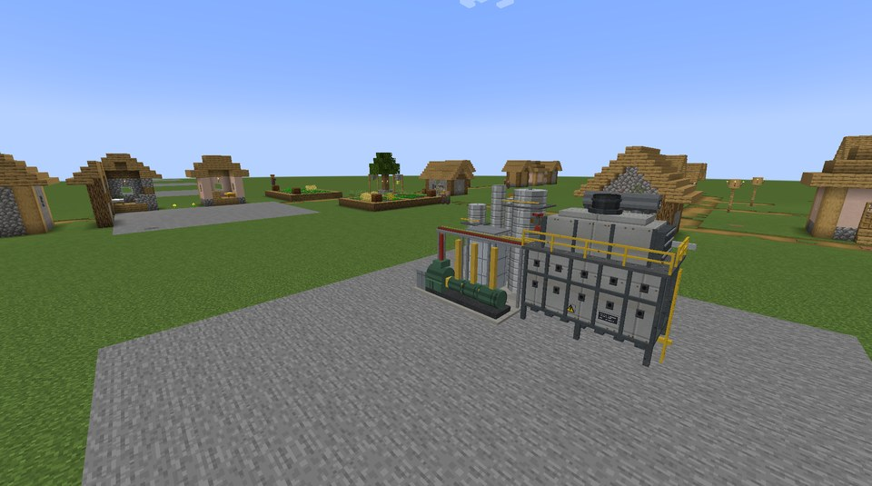 |
| I2: wellhead, separator, heater and column | I3: pyrolysis furnace |
| 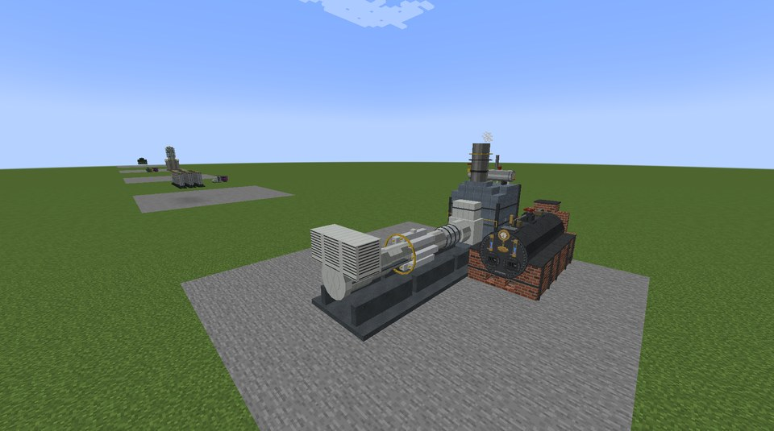 | 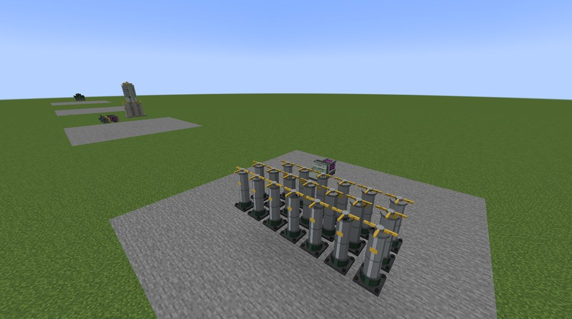 |
| I3: gas turbine and heat recovery boiler | I4: centrifuge enrichment cascade |

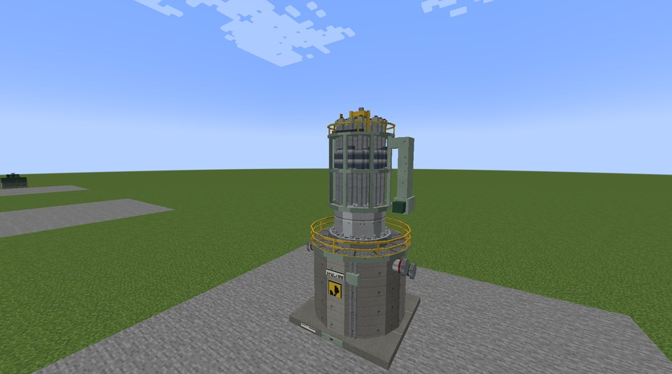

I4: the VVER reactor.
Some of the hand-made machine models of the later eras, from the 220 kV transformer to the compact reactor module:

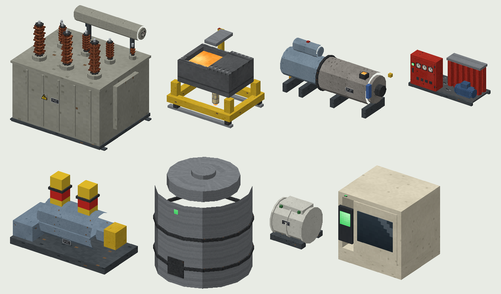

## Installation

1. Install Minecraft 1.21.1 with NeoForge 21.1.259 or newer and Java 21.
2. Put [Create](https://www.curseforge.com/minecraft/mc-mods/create) 6.0.11+ and the
   `promptcritical-*.jar` from the [latest release](https://github.com/denfry/Prompt_Critical/releases/latest)
   into `mods/`. Add [CC: Tweaked](https://www.curseforge.com/minecraft/mc-mods/cc-tweaked) 1.120.2+ if you want
   the DCS/SCADA level.
3. In game, the engineering handbook explains every machine and holds the route of tasks.

## About

Prompt Critical treats energy, oil and gas, metallurgy and chemistry as
engineering problems rather than "a block that outputs RF". You climb a ladder
of industries where each one consumes the products of the others, and at the top
sits a nuclear plant whose physics come from real equations: point kinetics with
delayed neutrons, xenon and samarium poisoning, two-phase thermal hydraulics on
IAPWS-IF97 water properties, decay heat.

Machines turn through [Create](https://github.com/Creators-of-Create/Create).
The control system is yours to build: relay cabinets first, then analog
computers, PLCs programmed in IEC 61131-3 languages, and finally a DCS/SCADA on
[CC: Tweaked](https://github.com/cc-tweaked/CC-Tweaked) computers. The mod
gives you sensors, function blocks and peripherals, not a ready-made "reactor
controller".

### Design pillars

| | Pillar | In practice |
|---|---|---|
| P1 | Physics over magic numbers | Every constant is either physical, with a source, or a documented balance value exposed in the config. |
| P2 | Readable through instruments | You learn the plant state from gauges, sound and vibration. Sensors have error and lag. |
| P3 | Automation is the gameplay | Parts, not solutions: sensors, registers, PID and cascade blocks, Lua. The control scheme is your design. |
| P4 | Proportionate consequences | Mistakes have realistic but server-bounded consequences through a damage budget. |
| P5 | Performance is a requirement | Simulation budget ≤ 3 ms/tick (p95) for the reference complex. |
| P6 | Safety by design | Hardware protection trips independently of Lua and PLCs. Rods fall by gravity when the drive is lost. |
| P7 | Connected industries | No chain is closed on itself: refinery sulfur leaches uranium, coke pitch becomes reactor graphite, diesel feeds the plant's emergency generators. |

### Industry eras

| Era | Name | Highlights | Typical reactor tier |
|---|---|---|---|
| I0 | Coal and steam | coal mine with methane and ventilation, coal boiler, steam engine driving a Create shaft | — |
| I1 | Steel and power | coke ovens, blast furnace, converter, seamless pipes; synchronous generator, power lines, transformers, protection relays | T0 graphite pile |
| I2 | Oil and gas | seismic survey, drilling and well control, refinery, gas processing plant, gas turbines | T1 |
| I3 | Chemistry | pyrolysis, polymers, chlor-alkali, syngas, ion-exchange resins, TBP | T2a / T2b, T3 |
| I4 | Nuclear | enrichment cascade, fuel assemblies, reprocessing, isotopes, RTGs | T3, T4 |

The automation ladder runs alongside: **A0** manual → **A1** relay logic →
**A2** analog computers → **A3** PLC and safety instrumented systems →
**A4** DCS/SCADA on CC: Tweaked → **A5** plant-level optimization.

See the [wiki](https://github.com/denfry/Prompt_Critical/wiki) for every system
in detail.

## Requirements

| Component | Version | |
|---|---|---|
| Minecraft | 1.21.1 | required |
| NeoForge | 21.1.259+ | required |
| Java | 21 | required |
| Create | 6.0.11+ | required |
| CC: Tweaked | 1.120.2+ | optional, needed for the DCS/SCADA level |

Without CC: Tweaked the plant runs on analog desks, relays and PLCs. Other
optional integrations (JEI/EMI, Jade, Serene Seasons, Simple Voice Chat, Sound
Physics Remastered, Xaero's maps, Distant Horizons) are planned as soft
dependencies.

## Building

```bash
git clone https://github.com/denfry/Prompt_Critical.git
cd Prompt_Critical
./gradlew build                     # compile, unit and architecture tests
./gradlew :pc-mod:runClient         # dev client
./gradlew :pc-mod:runGameTestServer # in-game tests
```

The jar ends up in `pc-mod/build/libs/`. Details are on the
[Building from Source](https://github.com/denfry/Prompt_Critical/wiki/Building-from-Source)
wiki page.

## Repository layout

```
pc-sim/      pure-Java simulation domain; must not import net.minecraft (ArchUnit-enforced)
pc-api/      public API for addons and integrations
pc-mod/      NeoForge binding: blocks, items, networking, Create and CC: Tweaked glue
art/         Blockbench sources, preview renders and the asset build scripts
site/        source of the project site on GitHub Pages
```

## Documentation

The [wiki](https://github.com/denfry/Prompt_Critical/wiki) covers the
mechanics, integrations, architecture and roadmap. It summarizes the game
design document, which is kept private.

## Contributing

Issues and design discussions are welcome. Read
[CONTRIBUTING.md](CONTRIBUTING.md) before opening a pull request.

## License

Copyright © 2026 denfry. All rights reserved. The source is public for reference.
Including the unmodified jar in modpacks is allowed; see [LICENSE](LICENSE).

Not affiliated with Mojang Studios, Microsoft, NeoForged, the Create team or the
CC: Tweaked project.
