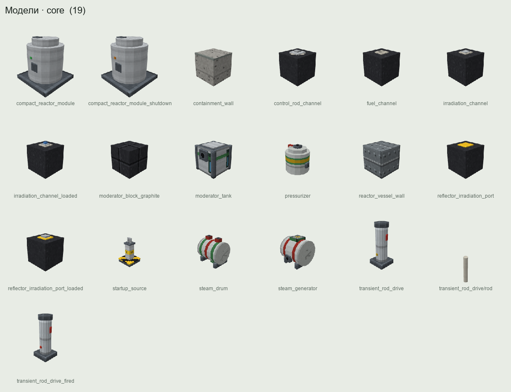

<div align="center">

# Prompt Critical

**An industrial complex for Minecraft, from the coal mine to the closed nuclear fuel cycle.**

Coal and steam, steel and power, oil and gas, chemistry and nuclear power,
run by plant I&C that you design and build yourself.

[](https://github.com/denfry/Prompt_Critical/actions/workflows/build.yml)


[](LICENSE)

[Site](https://denfry.github.io/Prompt_Critical/) ·
[Wiki](https://github.com/denfry/Prompt_Critical/wiki) ·
[Roadmap](https://github.com/denfry/Prompt_Critical/wiki/Roadmap) ·
[Building](https://github.com/denfry/Prompt_Critical/wiki/Building-from-Source)



</div>

> [!WARNING]
> **Alpha (0.1.0-alpha).** Milestone M2 is playable: era I0, coal and steam. Later
> eras described below and in the wiki are the design, not yet features. Expect
> balance changes and breaking world changes between alpha versions; back up
> your worlds.

### What is in the alpha

- **Coal mine**: vein worldgen with assays, methane and ventilation network with
  a main fan, ventilation doors and regulators, degasification, canaries and
  flame safety lamps, methane explosions with explosion barriers, timber and
  powered roof supports, a longwall shearer on a Create gantry, a mine hoist with
  headframe and cage, mine drainage and flooding.
- **Boiler room**: a Lancashire fire-tube boiler in brick setting with a chain
  grate stoker, chimney draft, fusible plug and relief valve, and a horizontal
  steam engine driving a Create shaft.
- **Foundry and machine shop**: cupola and crucible furnaces, sand moulds and a
  moulding machine, shakeout grate, lathe and drill press, coal jig.
- **Local instrument panels (A0)** on every machine: dial gauges, gauge glass,
  signal lamps, buttons and machine slots.
- **Engineering handbook**, operating procedures, a geological map,
  advancements and I0 decor blocks.

## About

Prompt Critical treats energy, oil and gas, metallurgy and chemistry as
engineering problems rather than "a block that outputs RF". You climb a ladder
of industries where each one consumes the products of the others, and at the top
sits a nuclear plant whose physics come from real equations: point kinetics with
delayed neutrons, xenon and samarium poisoning, two-phase thermal hydraulics on
IAPWS-IF97 water properties, decay heat.

Machines turn through [Create](https://github.com/Creators-of-Create/Create).
The control system is yours to build: relay cabinets first, then analog
computers, PLCs programmed in IEC 61131-3 languages, and finally a DCS/SCADA on
[CC: Tweaked](https://github.com/cc-tweaked/CC-Tweaked) computers. The mod
gives you sensors, function blocks and peripherals, not a ready-made "reactor
controller".

### Design pillars

| | Pillar | In practice |
|---|---|---|
| P1 | Physics over magic numbers | Every constant is either physical, with a source, or a documented balance value exposed in the config. |
| P2 | Readable through instruments | You learn the plant state from gauges, sound and vibration. Sensors have error and lag. |
| P3 | Automation is the gameplay | Parts, not solutions: sensors, registers, PID and cascade blocks, Lua. The control scheme is your design. |
| P4 | Proportionate consequences | Mistakes have realistic but server-bounded consequences through a damage budget. |
| P5 | Performance is a requirement | Simulation budget ≤ 3 ms/tick (p95) for the reference complex. |
| P6 | Safety by design | Hardware protection trips independently of Lua and PLCs. Rods fall by gravity when the drive is lost. |
| P7 | Connected industries | No chain is closed on itself: refinery sulfur leaches uranium, coke pitch becomes reactor graphite, diesel feeds the plant's emergency generators. |

### Industry eras

| Era | Name | Highlights | Typical reactor tier |
|---|---|---|---|
| I0 | Coal and steam | coal mine with methane and ventilation, coal boiler, steam engine driving a Create shaft | — |
| I1 | Steel and power | coke ovens, blast furnace, converter, seamless pipes; synchronous generator, power lines, transformers, protection relays | T0 graphite pile |
| I2 | Oil and gas | seismic survey, drilling and well control, refinery, gas processing plant, gas turbines | T1 |
| I3 | Chemistry | pyrolysis, polymers, chlor-alkali, syngas, ion-exchange resins, TBP | T2a / T2b, T3 |
| I4 | Nuclear | enrichment cascade, fuel assemblies, reprocessing, isotopes, RTGs | T3, T4 |

The automation ladder runs alongside: **A0** manual → **A1** relay logic →
**A2** analog computers → **A3** PLC and safety instrumented systems →
**A4** DCS/SCADA on CC: Tweaked → **A5** plant-level optimization.

See the [wiki](https://github.com/denfry/Prompt_Critical/wiki) for every system
in detail.

## Requirements

| Component | Version | |
|---|---|---|
| Minecraft | 1.21.1 | required |
| NeoForge | 21.1.259+ | required |
| Java | 21 | required |
| Create | 6.0.11+ | required |
| CC: Tweaked | 1.120.2+ | optional, needed for the DCS/SCADA level |

Without CC: Tweaked the plant runs on analog desks, relays and PLCs. Other
optional integrations (JEI/EMI, Jade, Serene Seasons, Simple Voice Chat, Sound
Physics Remastered, Xaero's maps, Distant Horizons) are planned as soft
dependencies.

## Building

```bash
git clone https://github.com/denfry/Prompt_Critical.git
cd Prompt_Critical
./gradlew build                     # compile, unit and architecture tests
./gradlew :pc-mod:runClient         # dev client
./gradlew :pc-mod:runGameTestServer # in-game tests
```

The jar ends up in `pc-mod/build/libs/`. Details are on the
[Building from Source](https://github.com/denfry/Prompt_Critical/wiki/Building-from-Source)
wiki page.

## Repository layout

```
pc-sim/      pure-Java simulation domain; must not import net.minecraft (ArchUnit-enforced)
pc-api/      public API for addons and integrations
pc-mod/      NeoForge binding: blocks, items, networking, Create and CC: Tweaked glue
art/         Blockbench sources, preview renders and the asset build scripts
```

## Documentation

The [wiki](https://github.com/denfry/Prompt_Critical/wiki) covers the
mechanics, integrations, architecture and roadmap. It summarizes the game
design document, which is kept private.

## Contributing

Issues and design discussions are welcome. Read
[CONTRIBUTING.md](CONTRIBUTING.md) before opening a pull request.

## License

Copyright © 2026 denfry. All rights reserved. The source is public for reference.
Including the unmodified jar in modpacks is allowed; see [LICENSE](LICENSE).

Not affiliated with Mojang Studios, Microsoft, NeoForged, the Create team or the
CC: Tweaked project.
